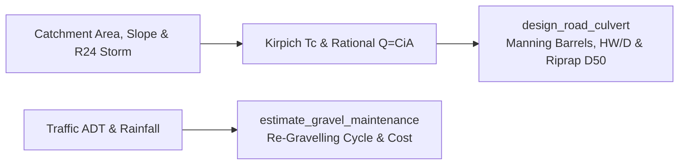

# culvert-opt

[](https://github.com/codesphere-u/culvert-opt/actions/workflows/ci.yml)
[](LICENSE)
[](pyproject.toml)
[](pyproject.toml)

**Zero-dependency rural feeder-road drainage & culvert hydraulics kit: Kirpich time of concentration, Rational Method peak runoff (Q=CiA), Manning circular culvert sizing, scour-velocity riprap apron guard, and re-gravelling budget.**

- **Mission Domain:** Transportation, Rural Civil Engineering & Climate Resilience
- **Stack:** Pure Python 3.11+ (zero runtime third-party dependencies, `mypy --strict`, `ruff`, `pytest`)
- **Maintainer:** Codesphere Innovations (U) Limited (`codesphere-u`)

---

## Problem Solved

Undersized district feeder-road culverts wash out every rainy season, severing smallholder farm-to-market access and district ambulance routes for weeks.

## Key Features

- Kirpich time of concentration (`kirpich_tc_minutes`), tropical short-duration IDF curve with climate-change rainfall uplift, and Rational Method peak storm runoff (`rational_peak_runoff_m3_s`).
- Manning circular precast concrete culvert sizer (`design_road_culvert`) selecting single or multi-barrel diameters (`600–1500 mm`) with debris freeboard, `HW/D <= 1.2` overtopping check, self-cleansing velocity check, and Isbash `D50` riprap scour-apron sizing.
- HDM-4-style laterite feeder-road annual gravel thickness loss and periodic re-gravelling budget estimator (`estimate_gravel_maintenance`).

## Architecture Overview



See [docs/architecture.md](docs/architecture.md) for module-level design details.

## Installation

```bash
git clone https://github.com/codesphere-u/culvert-opt.git
cd culvert-opt
uv sync --extra dev
```

Or install in editable mode with standard `pip`:

```bash
pip install -e ".[dev]"
```

## Quick Start (CLI)

```bash
culvert-opt --area-ha 35 --flow-length-m 750 --catchment-slope 0.04 --road-km 12
```

## Quick Start (Python API)

```python
from culvert_opt import CatchmentHydrology, design_road_culvert

design = design_road_culvert(CatchmentHydrology(catchment_area_ha=45.0, flow_length_m=600.0, catchment_slope=0.05))
assert design.total_capacity_80pct_full_m3_s >= design.design_peak_q_m3_s
```

## Testing & Quality Gates

```bash
uv run ruff check src tests
uv run mypy src
uv run pytest -v
```

## Security, Contributing & Roadmap

- **Security:** See [SECURITY.md](SECURITY.md) for responsible disclosure procedures.
- **Contributing:** See [CONTRIBUTING.md](CONTRIBUTING.md) and [CODE_OF_CONDUCT.md](CODE_OF_CONDUCT.md).
- **Changelog & Roadmap:** See [CHANGELOG.md](CHANGELOG.md) and [ROADMAP.md](ROADMAP.md).

## License

MIT License — see [LICENSE](LICENSE).

## Support & Contact

Open an issue on [GitHub Issues](https://github.com/codesphere-u/culvert-opt/issues) or contact `codesphereinnovationz@gmail.com`.
